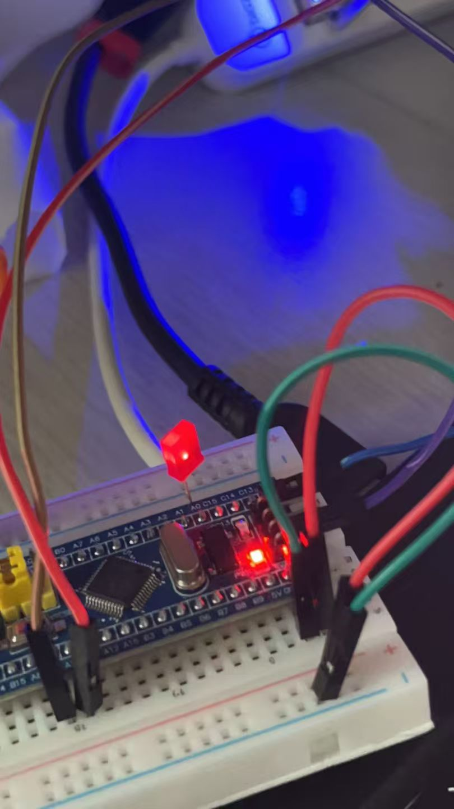

# 物联网招新任务Round 1

## 📖 项目简介
本项目完成了物联网招新第一轮的全部四个任务，从基础的 GPIO 控制逐步演进为包含传感器采集、双机通信、网页交互的完整物联网节点闭环。

## ✨ 任务完成列表
-  **任务一：基础控制**：实现了 STM32 对 LED 灯的基本控制。
-  **任务二：网页控灯**：搭建 ESP32 WebServer，实现局域网网页控制单灯。
-  **任务三：网页流水灯**：优化 STM32 状态机，实现网页远程启停流水灯效果。
-  **任务四：环境监测站**：接入 DHT11 传感器，STM32 采集数据通过串口发送至 ESP32，最终在网页上每 5 秒实时刷新显示温湿度。

## 📂 目录结构
- `round-1/project1/`：基础点灯工程
- `round-1/project2/`：网页控灯工程
- `round-1/project3/`：流水灯工程
- `round-1/project4/`：最终整合版（包含 DHT11 驱动、串口通信、网页动态渲染）

## 🔌 硬件连线
| STM32 引脚 | ESP32 引脚 | 说明 |
| :--- | :--- | :--- |
| `PA2 (TX)` | `GPIO16 (RX)` | 串口发送 |
| `PA3 (RX)` | `GPIO17 (TX)` | 串口接收 |
| `GND` | `GND` | **必须共地** |
| `PA0` | - | 接 DHT11 DATA 脚 |

## 📸 成果展示

## 🐛 踩坑与收获
- **DHT11 时序问题**：通过不断微调微秒级延时，成功解决湿度读数 159% 的乱码问题。
- **ESP32 串口乱码**：排查发现是解析逻辑位置不对，移动到 `loop()` 后完美解决。
- **Git 版本控制**：学会了使用 `.gitignore` 过滤 Keil 和 Arduino 的编译中间产物，让仓库保持纯粹。

## 👨‍💻 作者
- 姓名：[shuang]
- 专业：[软工]